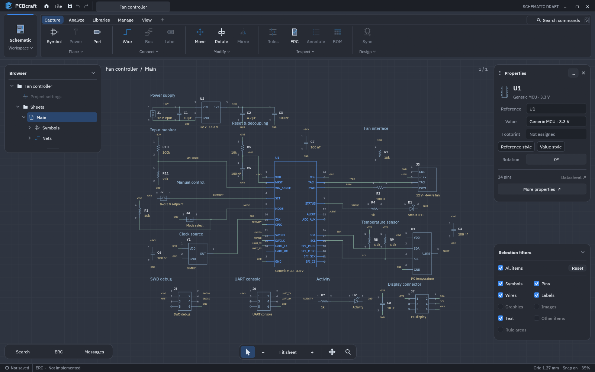
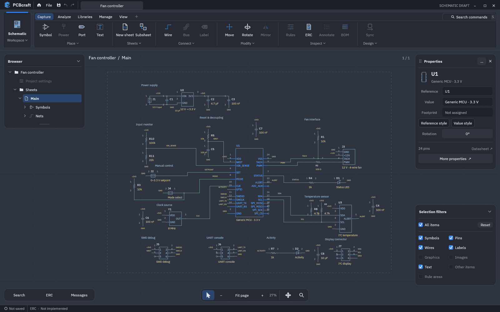

<h1 align="center">PCBcraft</h1>

<p align="center">
  <strong>A native workspace for electronics design.</strong><br>
  Schematic capture today. PCB layout, 3D and AI-assisted authoring on the roadmap.
</p>

<p align="center">
  <a href="#run-it">Run it</a> ·
  <a href="#ai-and-mcp">AI &amp; MCP</a> ·
  <a href="ROADMAP.md">Roadmap</a> ·
  <a href="docs/desktop-guide.md">Editor guide</a> ·
  <a href="docs/framework.md">Architecture</a> ·
  <a href="CONTRIBUTING.md">Contributing</a>
</p>

PCBcraft is a standalone Rust desktop application in the SolidCraft family,
built around an editable electronics project and a shared command/undo core.
The goal is to move naturally between schematic capture, board layout, 3D review
and manufacturing, whether designing by hand or working with an AI agent.

**Early development:** the schematic editor runs today. AI/MCP, PCB layout, 3D,
ERC/DRC, simulation and manufacturing are planned, not working features.



*Actual desktop build. The editable fan-controller example uses original generic
symbols; it is an illustrative draft, not an electrically validated reference design.*

## AI and MCP

**AI-assisted design is a core product requirement.** The planned in-app Assistant
and external Model Context Protocol (MCP) clients will use the same Electronics
session as manual tools: the same components, connections, validation and undo.

The intended workflow is **inspect → propose → preview → apply → undo**:

- Give the agent selected parts, sheets, terminals and actual connectivity, with
  versioned EDA guidance and an honest list of supported operations/checks.
- Propose component and connection changes as one reviewable transaction.
- Arrange selected circuitry with deterministic placement/routing constraints,
  preserving electrical intent and locked geometry instead of guessing coordinates.
- Apply an accepted proposal to the live editor, with one-step undo and protection
  against stale previews or repeated requests.

**Current status:** the headless session, typed editing operations, revision checks,
undo and occurrence-aware connectivity exist. **The MCP server, live-session bridge,
Assistant connection, atomic multi-command proposals and automatic arranger do not.**
There is no MCP launch command or client configuration to use yet.

The next AI implementation milestone is atomic prepare/apply with retry protection,
then an MCP bridge to the running app and a visible proposal review. This is early
schematic work, ahead of broad layout/manufacturing features.
See the [AI authoring spec and acceptance tasks](docs/specs/ai-authoring.md#next-bounded-implementation-sequence-and-acceptance).

## What works today

- **Schematic editing:** place, move, rotate and inspect eight built-in symbol
  types; select groups; edit styled notes, references, values and web links.
- **Editable wiring:** start from pins, wires or empty space; add bends and
  branches; drag segments/corners; delete connections and heal compatible overlaps.
- **Sheets and hierarchy:** flat sheets, reusable subsheets, interface ports,
  nested navigation and occurrence-qualified connectivity.
- **Net inspection:** highlight connected terminals, rename nets, review connection
  removal and copy a JSON connectivity report.
- **Native projects:** one project-wide history and experimental `.pc` save/open,
  including all sheets. Built-in symbols work offline.
- **Desktop workspace:** grouped ribbon, command search, floating/dockable Parts
  library and Properties panels, and a SolidCraft-derived dark visual foundation.

<details>
<summary><strong>Watch the desktop tour</strong> — schematic, Parts library and command search</summary>



A 12-second loop assembled from three still captures of the running app, four
seconds per state. It shows implemented UI, not a continuous interaction recording
or an AI-generated circuit. Static views: [schematic](docs/screenshots/schematic.png),
[Parts library](docs/screenshots/library.png), [command search](docs/screenshots/commands.png).
[Capture details and reproduction](docs/screenshots/README.md).

</details>

**Still ahead:** live AI/MCP authoring, ERC/DRC, PCB layout and cross-probing UI,
3D, simulation, external libraries, KiCad interchange and manufacturing outputs.
Unavailable workspace/tools are marked accordingly. `.pc` is provisional;
autosave and crash recovery are not implemented. See the detailed
[status and limits](docs/implementation-status.md) before relying on saved drafts.

## Roadmap

The next priority is AI-assisted schematic capture alongside editing reliability:
atomic proposals, live MCP, visible review and readable arrangement. Libraries,
ERC, the first board/DRC/cross-probing workflow, SolidCore-backed 3D, KiCad
interchange and manufacturing build on that foundation. UI quality and recovery
are part of each milestone.

The [product roadmap](ROADMAP.md) gives the working baseline, priorities and
acceptance gates without promising dates. Detailed tasks remain in the
[implementation plan](docs/implementation-plan.md).

## Run it

From a checkout, with **Rust 1.95+** and a desktop graphics environment:

```sh
cargo run --locked -- --demo
```

Omit `--demo` for an empty project, or open a saved project:

```sh
cargo run --locked -- path/to/project.pc
```

After dependencies are fetched, add `--offline`. The built executable is
`target/debug/pcbcraft`. The current build has been checked on Linux; packaged
releases and multi-platform qualification are still ahead. SolidCraft does not
need to be installed or checked out.

| Action | Control |
| --- | --- |
| Place a symbol / draw a wire / add text | **A** / **W** / **T** |
| Select / rotate / cancel | **V** / **R** / **Esc** |
| Box-select | Left-drag empty space or right-drag; Shift adds, Ctrl toggles |
| Context menu | Stationary right-click |
| Fit / zoom / pan | **F** / scroll / middle-drag |
| Command search | **S** |
| Undo / redo | **Ctrl+Z** / **Ctrl+Shift+Z** |
| Save / open | **Ctrl+S** / **Ctrl+O** |
| New flat sheet / hierarchical sheet | **Manage → Sheets → New sheet / Subsheet** |

Shortcuts defer to focused text fields. The [editor guide](docs/desktop-guide.md)
covers placement, panels and properties, with detailed guides for
[wire editing](docs/wire-editing.md), [selection/text](docs/selection-and-text.md),
[nets](docs/net-workflows.md) and [sheet workflows](docs/sheet-workflows.md).

## Development

The standalone egui app owns its Electronics model, session and native files.
It reuses qualified SolidCraft-family artwork/control patterns and targets
independent SolidCore geometry/rendering libraries as those features are added.
It has no dependency on the SolidCraft application, mechanical document engine
or Truck. See [architecture](docs/framework.md), the
[reuse register](docs/upstream-reuse-requests.md) and [standalone decision](docs/adr/0001-standalone-application.md).

Read [AGENTS.md](AGENTS.md), [requirements](docs/requirements.md),
[approved sources](docs/sources.md) and [development flow](docs/development-flow.md)
before contributing. The [implementation plan](docs/implementation-plan.md) and
[AI authoring tasks](docs/specs/ai-authoring.md#next-bounded-implementation-sequence-and-acceptance)
describe bounded next steps. No hosted CI or automatic agent/PR queue is configured.

```sh
cargo fmt --all -- --check
cargo check --offline --locked
cargo clippy --offline --locked --all-targets -- -D warnings
cargo test --offline --locked
cargo test --offline --locked --no-default-features
```

Tests cover editing, identity/connectivity, history, persistence and egui
interaction. The no-default-features run checks the core without desktop dependencies.

## Contributing and community

Read [CONTRIBUTING.md](CONTRIBUTING.md) for setup, focused PRs, validation and source
rules. [Issues](https://github.com/travle1/pcbcraft-next/issues) are the place for
reproducible bugs, questions and workflow proposals; [Support](SUPPORT.md) explains
what to include. The maintainer contact is [@travle1](https://github.com/travle1).

Participation follows the [Code of Conduct](CODE_OF_CONDUCT.md). Sensitive reports
use its private-follow-up process or the [security policy](SECURITY.md).
[Attribution](ATTRIBUTION.md) covers source/asset notices and truthful human/AI
commit credit, including tool/model co-authors and review-only assistance.

## License

Original contributions are available under [MIT](LICENSE-MIT) OR
[Apache-2.0](LICENSE-APACHE). Reused family artwork, controls and font retain their
[licenses and provenance](assets/family/README.md). KiCad support is planned as an
independent implementation from published specifications and black-box tests;
see the [source policy](AGENTS.md).
