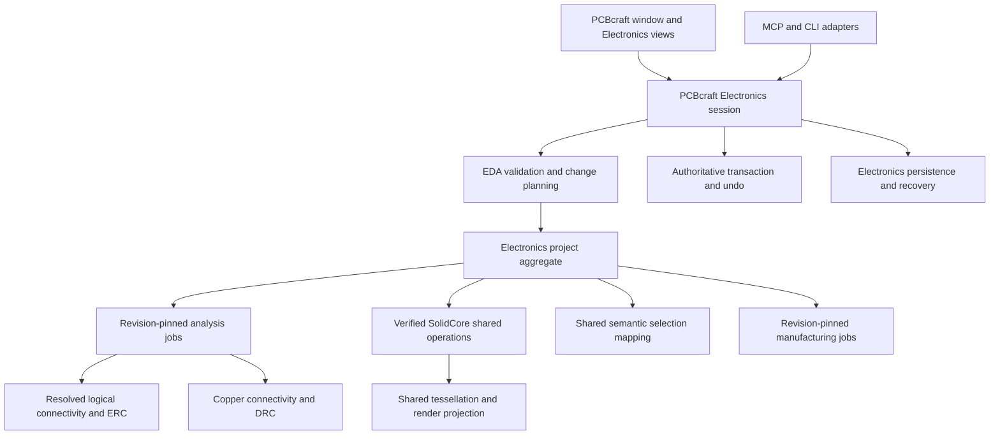

# PCB workspace framework

Status: standalone deployment corrected by the user November 3, 2026; see the
[accepted decision](adr/0001-standalone-application.md). The earlier Astra review
informed domain/runtime contracts; its host-deployment recommendation is superseded.
The first standalone schematic slice now runs; [implementation status](implementation-status.md)
separates its verified behavior from the broader plan below. Nothing is
manufacturing-qualified yet.

PCBcraft is a standalone PCB-design application in the SolidCraft family. It owns
its executable, application composition and Electronics session. Reuse verified
family libraries for icons/themes/controls and independent services, and SolidCore
for geometry. The SolidCraft app and mechanical engine are not required. Preserve
one authoritative EDA edit/history/save path for manual, imported and agent workflows.
The user's FigCraft designs determine the workspace composition and visual language.

## Specification map

| Read | Authority |
| --- | --- |
| [Requirements](requirements.md) | User goals and constraints |
| [Domain](specs/domain.md) | Authoritative electrical, schematic, library and board data; IDs, units and rules |
| [Standalone runtime and library reuse](specs/host-runtime.md) | Commands, transactions, events, cross-probing, jobs, UI and geometry adapters |
| [AI-assisted authoring](specs/ai-authoring.md) | First-class Assistant/MCP, versioned EDA guidance, circuit proposals and deterministic readable schematic arrangement |
| [Persistence and compatibility](specs/persistence.md) | Native Electronics aggregate/schema, versioning, assets, recovery and KiCad guarantees |
| [Geometry and outputs](specs/geometry-outputs.md) | SolidCore boundary, 3D alignment, routing analysis and manufacturing artifacts |
| [Checks and validation](specs/checks.md) | ERC/DRC coverage, rule explanations, waivers, testing and proposed budgets |
| [Workspace UI](specs/workspace-ui.md) | User-created FigCraft visual authority, shared egui reuse and interaction acceptance |
| [Implementation plan](implementation-plan.md) | Phases, acceptance gates, task dependencies and interface ownership |
| [Development flow](development-flow.md) | Isolated agents, review and future PR authority |
| [Sources](sources.md) | Approved references, inspected revisions and provenance constraints |
| [Astra review record](review-record.md) | Packet review, incorporated corrections and unproved implementation gates |
| [Upstream reference experiment](host-baseline.md) | SolidCraft build/startup evidence; not a PCBcraft dependency or acceptance gate |
| [Standalone decision](adr/0001-standalone-application.md) | Accepted product boundary, ownership and reuse requirements |
| [Historical host assessment](migrated-host-assessment.md) | Earlier PR #11360 evidence superseding extraction-first |
| [Upstream reuse requests](upstream-reuse-requests.md) | Bounded candidate library/API requests; none sent |

These documents define logical responsibilities, not a requirement to create a
crate per section. Begin within `pcbcraft-foundation`; split a module only when
dependency direction or a real second consumer warrants it. Proposed names and
interfaces below are not shipped SolidCraft/SolidCore APIs.

## Ownership and data flow

| Responsibility | Owner | State kind |
| --- | --- | --- |
| Component/terminal identity, schematic intent, board layout, rules, library snapshots, variants and mapping | Electronics project aggregate | Authoritative, persisted, undoable |
| Electronics identity/lifecycle, revision, undo/redo, save/recovery and semantic operations | PCBcraft Electronics session | One authority shared by all views and transports |
| Tabs/panels, command presentation and lifecycle UI | PCBcraft desktop composition with verified shared UI libraries | Independent executable; no full SolidCraft app/engine dependency |
| Net compilation, copper islands, ERC/DRC results, filled zones, spatial indexes | Analysis services | Derived, revision/input-hash tagged; rebuildable |
| Meshes, GPU resources, thumbnails, hit-test acceleration | Shared geometry/render adapters | Disposable projections; never electrical truth |
| Canonical selection, separate hover/highlight and view projections | Electronics interaction service | Transient state; views never re-emit projected selection |
| Cameras, dock/workspace state | PCBcraft editor state using independent shared utilities | Session preferences, separate from electrical undo |
| File-format source trees, imported-ID maps, supported/opaque sections | Compatibility adapter with document references | Preservation/provenance data, versioned and saved when required |
| Supplier availability/prices | Optional sourcing adapter | Timestamped external observations; cannot silently mutate design |

Changes commit once through the authoritative session, then publish one revisioned change event.
Analysis consumes the resulting immutable snapshot. Schematic, layout and 3D
subscribe to the same semantic identities; they do not synchronize by matching
labels or exchanging independent private documents.

## Framework decisions

**Required direction:** standalone PCBcraft application, maximum practical family
library reuse, SolidCore-first geometry, KiCad compatibility, reproducible
libraries and manual/PCB-only/agent-assisted workflows. No Truck or preserved GPL
implementation/fixtures. KiCad implementation-source inspection is prohibited.

**Ownership:** PCBcraft's Electronics session owns its aggregate, commands,
history/revisions and save/recovery. Independently consumable utilities can serve
that session, without a dependency on SolidCraft's mechanical Session or Document.
Schematic, Layout and Render are views of one project inside PCBcraft.

**Native projects:** .pc is provisional; use a distinct schema/type marker and
separate intent from derived analysis. Reusable container code does not impose
.sc or mechanical semantics. Possible later .sc export requires an explicit
semantic adapter. Encoding remains a decision for F1/F0.

**Implementation:** W0 qualifies standalone application/library boundaries; F1
defines minimal semantic contracts. W1 builds PCBcraft's visible workspace and
H0 proves edit/undo/save/reopen using the same session as headless adapters.
Neither a universal shared shell SDK nor the whole upstream build is a gate.
Exact reusable packages/extraction APIs, native encoding, initial external-format
profiles and advanced-feature priorities remain open. Runtime plugins and
cross-document ECAD/MCAD transactions are outside initial scope.

## Required workflows

1. **Capture-led:** choose a resolved component, place symbol units on sheets,
   connect terminals, compile/check, review an ECO, place/route PCB, cross-probe,
   inspect 3D and generate a validated output set from a pinned revision.
2. **PCB-only:** create/import board data and board-local electrical intent,
   place independent footprints, assign/connect pads, route/check and export.
   No fabricated schematic or component is required. Later linking is explicit.
3. **Existing-project work:** inspect import coverage, retain foreign IDs and
   opaque data, make supported edits, preview compatibility/export consequences,
   and preserve or report what cannot round-trip.
4. **Agent-assisted:** inspect capabilities, context, resolved definitions and
   revision; propose components and terminal connections; arrange readable blocks
   with deterministic constraints; preview electrical/presentation differences;
   review/apply once with revision guards and undo. An arrange-only operation
   preserves connectivity exactly. In-app Assistant and external MCP share these
   operations; a concurrent user edit yields a conflict rather than overwritten work.
5. **Library change:** compare pinned definitions and local overrides with a
   proposed revision, resolve pin/pad and route-impact conflicts, and apply one
   reviewed upgrade transaction without requiring a cloud catalog.

## Failure and honesty contract

Invalid IDs, missing required references, nonfinite/out-of-range quantities,
inconsistent mappings and unsupported destructive conversions reject a change
without altering document, allocation state or history. Temporary electrical or
clearance violations may remain in a structurally valid document; checks report
them and the active routing/export policy determines whether they block that
operation. Never label partial/stale checks as a clean complete design.

Missing optional 3D data degrades the scene without invalidating electrical
facts. Missing electrical geometry/mapping blocks affected checks or release.
Unsupported host or SolidCore capabilities return a named capability blocker;
there is no Truck fallback. Failed jobs publish no partial mutation or completed
fabrication package. Cancellation before atomic publish prevents publication;
a completed publish wins that race and returns AlreadyCompleted. Preserve the
original file and current editor state on load/migration/save failures.

## Verified reuse opportunities and limits

The [reference experiment](host-baseline.md) verifies SolidCraft at c553365 builds
and renders on this machine without Truck; its CLI fails separately. This is
evidence about upstream, not a PCBcraft launch or dependency requirement.

SolidCraft's UI crate still depends on its mechanical engine; some public widgets
and private controls therefore need a narrower independent library boundary.
Its Document/Session, FileKind and command registry are application-specific.
PCBcraft must own those EDA responsibilities. Shared container, atomic-write,
job, history and rendering utilities are candidates only when their independent
API and dependency closure are proven. Metadata is not a home for EDA state.

The [reuse request register](upstream-reuse-requests.md) names focused extraction
needs and temporary-adapter criteria. Direct SolidCore crate consumption is a
separate concern: qualify only needed geometry APIs, units, versions and behavior.
Do not gate basic workspace/model work on all geometry or upstream app tests.

The independent local icon project at `/home/travisl/projects/solidcraft-icons`
contains a pinned SVG catalog and review tooling. It has no consumer package API
or application integration yet. Use its semantic masters/palette/style and
provenance when the adapter is deliberately selected; do not treat it as a ready
dependency or edit it as part of this specification task.

The first complete milestone is the **standalone Electronics workspace**: PCBcraft's
own window and reusable family controls and three views matching the user's renderings, one original editable
component, browser/inspector/layers/selection, a semantic edit with undo/redo,
provisional `.pc` save/reopen, cross-selection and GUI/API operation parity.
Unfinished tools are disabled honestly. Routing, full checks, KiCad and
manufacturing are not prerequisites. W0 standalone/library qualification and minimal F1 contracts can start
together; contracts precede persistence implementation. Original headless identity
and concurrency fixtures accompany the UI, including repeated sheet occurrences,
multiunit/non-bijective mappings, stale ECO and jobs after undo/reopen. See the
[implementation plan](implementation-plan.md) for dependencies and later scope.
