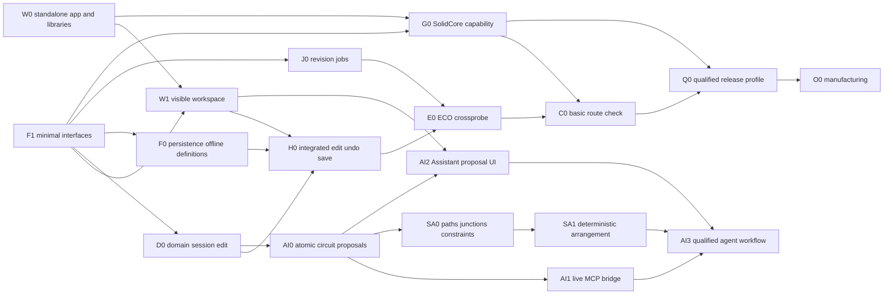

# Implementation gates and agent backlog

Status: deployment corrected November 3, 2026 by explicit user direction.
PCBcraft is a standalone app; [accepted decision](adr/0001-standalone-application.md).
A standalone schematic-only slice is implemented; see [status and remaining gates](implementation-status.md).
This does not complete the full three-view milestone. Repository hosting is recorded
in [development flow](development-flow.md); no agents or queue were launched.
[Framework](framework.md), [review record](review-record.md).
The concise [product roadmap](../ROADMAP.md) summarizes priorities. This document
retains the detailed acceptance gates; they are not all completed by the current
schematic implementation.

## Standalone base workspace route

W0 establishes PCBcraft's own desktop target and independently consumable library
boundary. The separate [SolidCraft startup experiment](host-baseline.md) informs
reuse; it is not PCBcraft, a required runtime or a completed standalone gate.
Its CLI compile failure does not block this product.

Map actual egui/icon/theme/control utilities to independent packages, exact pins,
licenses, feature closure and minimal consumer APIs. Public exports in
solidcraft-ui-egui still bring a mechanical-engine dependency and cannot simply
be imported wholesale. Needed app-private components require a focused library
extraction/request or a reviewed licensed temporary adapter with replacement plan.
PCBcraft owns application composition and need not wait for a universal shell SDK.
No invented shared crate, full application fork or sibling checkout dependency.

W0's runnable proof is PCBcraft's own egui window, application identity/settings
and minimal verified shared visual resource/control use. It must build from its
own checkout and declared dependencies without the SolidCraft app/engine. A blank
or partial proof must be labeled as such; actual three-view UI belongs to W1.
Use the user's FigCraft layout and preserve a coherent family appearance.

F1 defines Electronics identities/quantities/operations and the one PCBcraft
session contract. Generic transaction/IO/job utilities may be reused independently;
do not adapt the mechanical Session or feature tree into an electrical document.
W0 and F1 are independent until W1 consumes both. Settle shared interfaces before
parallel work. Contracts precede production persistence; no agents are launched
because tasks can run in parallel.

The first complete workspace milestone is intentionally small: PCBcraft window;
Schematic/Layout/Render views; one original editable component; browser/inspector/
layers/selection; semantic edit and undo/redo; provisional .pc save/reopen;
cross-selection and GUI/API parity. Unsupported tools are honestly disabled.
Routing, full checks, KiCad and manufacturing come later. Missing advanced
geometry cannot block the standalone window or basic domain model.

## Phases and coverage

Current schematic follow-up: explicit-link net compilation, naming, reviewed
disconnect/undo and a JSON report are implemented; see [net workflows](net-workflows.md).
First-class AI-assisted capture now has a bounded AI0/AI1 implementation and
initial review UI/guidance; see [MCP setup and limits](mcp.md). Next work expands
arrangement, schematic operations and in-app provider conversation. The
[AI authoring spec](specs/ai-authoring.md) owns AI0–AI3 and SA0–SA1 task scopes,
source evidence and acceptance; these are early work, not deferred until PCB/3D.
An external connectivity adapter remains separate. Settle component/pad mapping
before the first layout/ECO slice. Prefer one project window with optional schematic/layout split;
do not build separate documents or histories per view. Simulate is visible as
Planned, with solver/models/export deferred. The current project compiler includes
explicit hierarchical port bridges; global labels, buses and full ERC are still
unimplemented. See [sheet workflow coverage](sheet-workflows.md).

| Phase | Deliverable and exit gate |
| --- | --- |
| A | W0 standalone executable/library boundary and F1 minimal contracts; own launch, selected independent dependencies and CORE-1 fixtures |
| B | W1 visible workspace plus D0 session/edit and F0 native save/offline used definitions; H0 proves PCBcraft edit/undo/save/reopen/parity |
| B, AI-assisted capture | AI0/AI1 shared proposals and live MCP; SA0/SA1 explicit paths and constrained arrangement; AI2/AI3 Assistant review and one qualified backend. Supported structural checks first; no invented ERC coverage |
| C | J0 jobs and E0 reviewed ECO/crossprobe; G0 verified SolidCore capability/profile; then bounded C0 route/check workflow |
| D | Qualified geometry/check/release coverage and O0 pinned manufacturing package; independent output inspection |
| E | Hierarchy breadth/buses/full multiunit ERC, zones, richer rules/stackups, upgrades/variants and named KiCad profile, each with coverage fixtures |
| F | Differential pairs/tuning, shove, advanced vias/flex where supported, richer DFM/MCAD exchange under separate capabilities |
| Deferred | Autorouting, SPICE/SI/PI, real-time multiuser, enterprise PLM, IPC-2581/ODB++ and mandatory cloud sourcing require separate decisions |

Alongside the UI, original headless correctness fixtures cover a repeated sheet
with two occurrences, multiunit one physical part, non-bijective pin/pad mappings,
a stale ECO, and job delivery after undo and reopen. Fixtures exercise the same
operations as GUI/MCP. Unsupported mappings reject rather than silently simplify.

The later complete board fixture uses an original two-pin component and connector,
two nets, simple two-layer outline/holes and rules. Capture/connect, ERC, ECO,
place/route, cross-probe, DRC, offline reopen and coherent output set follow the
base workspace. Include clearance failure and missing optional model. No release
with missing required checks/geometry. Fan Controller artwork is visual authority,
not an electrical implementation fixture.

## Dependencies and bounded tasks

The table below describes intended task scope and gates, not a requirement for new
packages. Existing modules satisfy some subsets; current evidence is recorded in
[implementation status](implementation-status.md). F1 owns
shared semantics; W0 owns PCBcraft desktop bootstrapping and the shared-library
boundary, coordinating their small overlap. Contracts precede persistence implementation. Do not create one
crate per concept or edit shared manifests/schema/registries concurrently.

| Task | Allowed area / bounded outcome | Acceptance |
| --- | --- | --- |
| W0 | Own desktop target/manifest and library reuse contracts; package layout settled by this task | Clean-checkout PCBcraft build/start with only declared pinned dependencies; no SolidCraft app/engine/sibling path or Truck; own settings, resource provenance, selected graph audit |
| F1 | Proposed identity/quantity/operation/snapshot contracts and original fixtures; domain/session owner | Opaque typed IDs, quantity bounds/overflow/tolerances, runtime incarnation/revision/idempotency, atomic candidate validation; CORE-1/TX-1 subset |
| W1 | PCBcraft desktop composition, shared-control adapters, Electronics panels/three views and UI tests | Verified family theme/icons, user's composition in our executable, canonical selection, disabled tools; UI-1 subset |
| D0 | Domain modules and PCBcraft Electronics session, plus own tests | One component/edit/undo/redo, single aggregate authority, repeated occurrence/multiunit/non-bijective fixtures; GUI/API same operation |
| F0 | Proposed persistence/resolver modules and original assets; no revision ownership | Native `.pc` schema/marker and bounded container utility reuse; pinned used definitions offline, IO-1/LIB-1 subset, conservative association |
| J0 | Proposed job/fingerprint adapters and deterministic completion tests | JOB-1, undo/reopen/session-switch freshness, cancellation/publication race |
| H0 | PCBcraft application integration/tests; shared files assigned to one integrator | Own app edit/undo/redo/save/reopen/cross-selection and operation parity; one Electronics session/history |
| E0 | Proposed reconciliation/mapping and tests | ECO-1, one-many/occurrence selection, stale apply reject, board-local/deletion conflicts and one undo |
| G0 | Capability matrix and narrow adapter/original asymmetric fixtures | Actual planar/3D operation coverage, unit/origin/mirror/layer-Z/model transform tests; no electrical IDs owned by geometry |
| C0 | Proposed basic routes/checks and own fixtures | CHECK-1 for explicitly supported primitives/rules; unavailable advanced geometry cannot imply a pass |
| Q0 | Release profile/check coverage and original golden cases | Required geometry/checks/assets/settings qualified, DNP policy and independent oracle evidence |
| O0 | Proposed output adapters/manifest and original fixtures | OUT-1 pinned output set, qualified tool/profile reproducibility and atomic publication/cancel behavior |
| K0 later | Independent compatibility fixtures/coverage and selected adapter task | Named KiCad profile no-op/edit/unsafe-loss refusal; approved public sources only, not a base-workspace gate |

## Ownership lanes and future review

After contract agreement, four lanes can work in disjoint areas: standalone desktop/shared-UI
owner; domain/authoritative-session owner also owning shared semantic contracts; persistence/
library owner with no second revision authority; geometry/projection owner with
no electrical identity or alternative kernel. Tests/MCP are consumers of the
same operations. F0/D0/J0 can proceed after F1 while W1 uses W0+F1; dependent
integration remains sequential at H0/E0 and qualified manufacturing gates.

Use [task briefs](development-flow.md#task-brief), isolated worktrees, explicit
base/prerequisite SHAs and named shared-file owners. Integrator checks combined
behavior/provenance and resolves overlap without discarding others' work. Merge
prerequisites before dependents by default. Future authorized PRs state concrete
behavior, limits, fixture/visual evidence, checks, attribution and blockers.
The standalone `origin` is `https://github.com/travle1/pcbcraft-next.git`;
upstream work needs current target rules and explicit authority. This backlog
does not itself authorize launches, queue configuration, pushes, PRs or merges.

## Still open

Independently consumable UI packages and replacement of temporary adapters;
broader component/terminal/pad contracts, atomic proposals/idempotency and full
project asset/library storage; native encoding evolution and .pc associations;
first KiCad/manufacturing profiles; multi-board MVP limit; density and reference-
machine budgets. The existing Rust package/desktop target, IDs/quantity bounds and
experimental version 7 project format are implemented subsets, not open first steps.
Standalone deployment and PCBcraft session ownership are decided. PCBcraft launch
is verified; an independent upstream UI-library extraction is not.

See the [upstream reuse request register](upstream-reuse-requests.md) before
proposing library extraction. It plans bounded requests and sends nothing.

## Sheet workflow follow-up

The browser follows the user's FigCraft navigation. [Flat/hierarchical sheet work](sheet-workflows.md)
now implements definition/occurrence ownership, creation/navigation/scoped edits,
child symbols/ports, project connectivity and native migration with shared undo/save.
Occurrence-qualified probe targets leave a hook for layout; cross-view UI is not
implemented. Global labels, buses, multiunit breadth and advanced hierarchy editing
remain follow-ups. Preserve whole-project undo/save/reopen and isolation fixtures.
