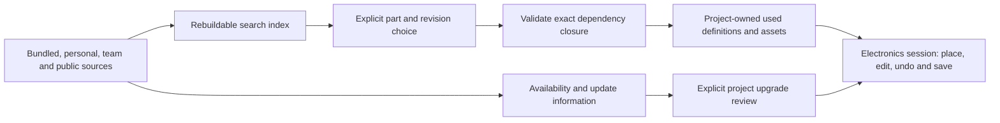

# Library management

Status: **draft for product review**, November 4, 2026. This specifies proposed
behavior, not implemented libraries, qualified parts or a selected catalog vendor.
It develops the existing [requirements](../requirements.md#library-management-is-a-core-contract),
[domain](domain.md#component-selection-libraries-and-assemblies) and
[persistence](persistence.md#dependencies-assets-and-path-safety) contracts.
[Research, evidence limits and source boundary](../library-management-research.md).

## Product direction

PCBcraft should let someone find a useful part, place it and share the design
without first becoming a library administrator. A small maintained starter
collection should work immediately. The project should retain the exact
definitions and required assets it uses, so another installation can open it
without reproducing the author's library paths, accounts or installed versions.

The same system must accommodate a personal folder, a Git-managed team collection,
an approved-parts database, a public catalog or an offline installation. These
change where parts are discovered and which choices a workflow permits. They do
not change the identity, project snapshot or update contracts underneath designs.
No cloud account, company database or supplier integration is required to edit.

The working assumption is that generic circuit building and manufacturer-part
selection are equally important. A generic resistor is a valid design choice;
an orderable device is a more specific selection, not a prerequisite for drawing
a circuit. A convincing preview or manufacturer number alone does not establish
that its symbol, land pattern or pin mapping is correct.

## Current baseline and first gaps

The editor currently offers twelve original built-in symbol types. Components
store `PartKind`, reference and value; a saved built-in definition version selects
application-supplied geometry and terminals. General external definitions,
project-embedded arbitrary symbol drawings, footprints, supplier search, library
authoring and library upgrade review are not implemented. The existing Parts
panel is useful UI to extend, not evidence that the contracts below already work.

The first foundation must replace that closed catalog assumption with explicit
resolved definitions while preserving existing projects. It must not wait for
the board editor, a marketplace or the complete team-management feature set.

## Outcomes and boundaries

| Outcome | Required evidence |
| --- | --- |
| Useful immediately | A fresh native installation finds and places bundled starter symbols with no login, library setup or network request. The browser offers the same starter after loading the application. |
| Portable projects | A project with used definitions opens on a clean installation with its source folders, registries and credentials absent. Supported geometry, connections and choices are unchanged. |
| Predictable change | Installing, refreshing, renaming or removing a source changes discovery, not existing project definitions. A project upgrade is a separate reviewed transaction. |
| Practical customization | A user can customize one placed part locally and reuse it later without editing a read-only starter collection or silently changing other projects. |
| Team workflows | A shared collection and approval rules can be adopted without converting projects to a different library model. Source relocation is not a part replacement. |
| Honest completeness | Symbol coverage, footprint/mapping coverage, review evidence and purchasing information are separate facts. Missing coverage remains visible. |

This spec does not implement full PLM, purchasing, live collaboration, a runtime
plugin system, arbitrary database scripting, electrical validation or a complete
external-format converter. KiCad-specific implementation and any source-derived
resolution/rescue work remain subject to the unresolved research boundary noted
in the research record; this document does not authorize them.

## Default experience

The Parts panel opens ready to search. Its default scope includes the bundled
starter, definitions already in the project and sources the user deliberately
enabled. Exact part numbers, familiar names and typed parameters should work
without knowing a library filename. The panel shows why a result is relevant,
its source and the information needed to choose it. It does not force an install
wizard or separate symbol/footprint searches for a complete part.

| User action | Default behavior |
| --- | --- |
| Search for a generic part | Offer a symbol and its editable electrical parameters. Physical realization may be assigned later. |
| Search for an exact manufacturer part | Prefer exact manufacturer/ordering-code matches, showing package variant and available symbol/mapping evidence. Similar names stay separate choices. |
| Place an existing project part again | Reuse its captured revision. A newer source revision is a distinct available choice. |
| Place a complete device | Resolve its required dependency closure, capture it into the project and place it through one normal Session operation. Failure leaves no partial placement. |
| Place a symbol without a footprint | Allow schematic work and identify the missing physical selection where relevant. Do not claim PCB readiness. |
| Edit a placed part | Offer instance properties or an explicit project-local definition change, with affected uses shown. Do not overwrite its source library. |
| Import a downloaded part | Stage the file/pack, show represented objects, mappings, omissions and provenance, then add an editable copy or approved read-only artifact. |
| Share a project | Include its used definitions and required permitted assets. Report any external-only or missing dependency before describing the result as portable. |

The browser's first page load still needs the application assets. Offline project
data must not be confused with an installable offline web application: reliable
offline reload requires separately qualified browser caching/storage. Browser
downloads also retain their existing inability to confirm durable saves.

### Starter content is a maintained product

Ship **Core symbols** for generic circuit capture and a separately versioned
**Starter parts** collection of concrete physical selections. Both are available
from the same search; users should not have to understand their packaging to
place a part. The concrete collection should initially cover a modest useful
range of passives, connectors, protection, switching, basic analog, power and
digital parts rather than advertise an unreviewed catalog size.

Starter-part scope, exact parts, data sources, redistribution conditions and
ongoing maintenance ownership are a release gate, not decisions made by this
draft. The shipped collection must have documented rights for its actual native,
web and project-embedding use. No vendor feed or third-party library is approved
merely by being named here. Offer larger packs on demand rather than downloading
every 3D model or catalog at first launch.

Each concrete selection needs review evidence for the exact package/ordering
variant, terminal functions, symbol mapping, pad mapping and supported footprint
geometry. Record the primary reference and revision/date, reviewer/check scope
and known limits. Optional 3D is identified separately. Existing illustrative
controller/module symbols remain illustrative; giving them a part number must
not turn them into verified manufacturer definitions.

Application updates may ship a new starter release. Existing projects keep their
captured revisions, and the user can review available updates. A published
correction or withdrawal must identify affected revisions and reachable uses;
it must not erase the geometry needed to inspect an old design.

## Definitions, selections and provenance

Keep the following concepts distinct in storage and APIs even when a placement
card presents them together. These are semantic contracts, not proposed Rust
crate names or a requirement to expose every concept in the default UI.

| Record | Owns |
| --- | --- |
| Logical component definition | Stable terminal identities, functions, electrical types and supported units/configurations; no purchasing requirement. |
| Symbol representation | Drawing, units/styles, pin anchors and explicit pin-to-terminal correspondence. |
| Package description | Physical body/package characteristics; a package name alone does not select a land pattern. |
| Footprint definition | Distinct pad identities/numbers, geometry/layers, origin, orientation and declared physical constraints. |
| Physical selection | Exact component/package/footprint revisions and terminal-to-pad relation, including supported configuration and assembly requirements. It can be generic and have no manufacturer number. |
| Manufacturer choice | Manufacturer identity and complete ordering code/package variant, its evidence and compatibility with a physical selection. |
| Supplier observation | Supplier SKU, price/currency, stock, region, quantity breaks, retrieval time and source. It does not own electrical definition or compatibility. |
| Release and evidence | Immutable artifacts/dependencies/notices plus publisher revision, review evidence and provenance. Lifecycle observations can change separately. |

Many pads may map to one terminal, and mechanical pads may map to none. Multiple
symbol units may represent one component. Pin numbers are labels, not durable
electrical identities or a universal bijection. Unsupported relations reject
with a named capability limitation; they cannot be simplified silently.

Manufacturer lifecycle, publisher release status, team approval and verification
coverage are separate. For example, a datasheet-checked footprint may belong to
an obsolete manufacturer part, and a team-approved symbol may still lack a
qualified footprint. Show each relevant fact with scope, origin and freshness;
avoid a universal green “verified” state.

An artifact has a durable publisher/namespace and definition identity, an exact
revision reference and a content digest. Human-readable names, source paths and
Git branches are locators or labels. Content deduplication does not merge two
parts' identities or prove that two manufacturers' parts are interchangeable.
Imports with no upstream identity receive an explicit local identity and retained
source provenance; never invent an upstream UUID, release or manufacturer fact.

L0 must specify canonical serialization, digest algorithm, dependency coverage
and immutable-release rules before implementation. Preserve original imported
byte identity separately from converted native-content identity. A claimed exact
revision that returns different content is a source conflict, not an update.
A digest establishes byte identity, not publisher authenticity or electrical
correctness. Official/team release trust needs separately qualified publisher
provenance; a project cannot make a new source trusted by declaring itself approved.

## Sources, discovery and deterministic resolution

A source adapter discovers releases and retrieves exact artifacts. A resolver
validates a selected immutable closure. A search index and local download cache
are disposable aids. Only project-owned definitions/bindings are authoritative
for that design. Source watchers and background sync never commit electrical edits.

| Source | Expected workflow | Browser boundary |
| --- | --- | --- |
| Bundled starter | Ready at launch; read-only release with editable copies. | Bundled with the application or its explicitly loaded packs. |
| Project definitions | Captured used parts and deliberate local additions; no external setup. | Stored in the project, with upload/download until persistent storage is qualified. |
| Personal folder/pack | Add a folder or pack once; create/reuse personal parts. | Pack upload/download works without claiming persistent arbitrary folder access. |
| Team Git/filesystem | Use an exact published revision from a configured folder or repository; drafts are not silently treated as releases. | Explicit packs or a qualified HTTPS adapter; no assumed local Git process or shared-drive access. |
| Team/public HTTPS catalog | Search/fetch published artifacts with explicit credentials/access rules where needed. | Requires qualified origin/CORS/authentication behavior; static Pages is not a private API proxy. |
| Company database | Map internal part records, approvals and approved choices through a bounded adapter. | Needs an explicitly configured service; do not embed database credentials or arbitrary SQL in the project. |

Adding a source is an application/workspace preference. Projects store logical
source provenance and exact used artifacts, not another user's absolute folder
paths, passwords or personal library-table setup. A shared profile can suggest
source mappings; opening a file does not execute them or silently connect to hosts.

| Situation | Resolution rule |
| --- | --- |
| Reopen an already-bound instance | Use its project snapshot, regardless of installed catalogs or source priority. |
| Source is renamed, moved or removed | Retain the snapshot. Offer source relocation for discovery/updates without rebinding its parts. |
| Two sources contain the same display name/MPN | Show distinct identities and exact variants. Require a selection; order is not an electrical resolution rule. |
| A mirror offers the same artifact identity and digest | Reuse its bytes with recorded provenance; transport relocation is not a design upgrade. |
| An exact revision returns different bytes | Quarantine that response and report the mismatch. Keep the captured project data. |
| A used artifact is absent/corrupt in the project | Diagnose the exact missing dependency. Recover only an exact validated artifact with authorized access; do not substitute a current lookalike. |
| Multiple project uses request incompatible revisions | Keep explicit coexisting revisions where the schema supports them; otherwise reject the proposal with the conflict. Never apply “highest version wins.” |
| Search/index changes after a user or agent chooses a result | Placement resolves the captured identity/digest token or rejects it; it does not repeat a name search and pick a different part. |

Search should rank exact identifiers before aliases and parameter similarity,
then apply the selected workflow's approved-source preferences. The ordering must
be explainable and stable for a fixed index/profile; sponsored results and live
stock must not silently override compatibility or exact identity. Already-used
revisions stay distinguishable from newer candidates. Name/MPN duplicate detection
can suggest consolidation, but consolidation is an explicit identity decision.

Search and filters need typed parameters and unit-aware comparisons. Preserve
full manufacturer ordering codes and distinguish electrical/package variants
from supplier packaging. Do not discard suffixes to manufacture an exact match,
treat unknown ratings as passing a filter, or infer physical dimensions from an
ambiguous package label. Show assumptions when parsing a shorthand query, and
keep original imported text alongside normalized supported values.

Public online search is an explicit action or opted-in source setting. Local
search and private part names must not automatically be sent to public providers.
Source outages retain local results and identify unavailable coverage rather than
turn a partial search into “no such part.”

## Project snapshots, caching and sharing

Capture the used dependency closure at placement or an explicit add-to-project
operation: definitions, mappings, required assets and their provenance/notices.
Deduplicate immutable content across uses inside the project; do not embed an
entire catalog or repeat a model in every component. Keep required symbol/pad
data distinct from optional thumbnails, search indexes and optional models.

The default project is portable. A workflow may deliberately retain an external
asset when rights, size or access requirements demand it, but the project must
show that portability exception, its exact digest and affected capabilities.
Sharing/export must report unresolved exceptions. A profile change must not
silently strip existing embedded content, provenance or required notices.

Library data rights are qualified separately from application code. Missing or
unknown rights remain explicit metadata; importing a user's draft is not a claim
that it can be bundled publicly. Official packs/publication require qualified
redistribution and embedding terms. Credentials and restricted source URLs must
not leak into a shared file; necessary attribution cannot be removed as a privacy
shortcut. A sanitized share operation reports what it changed or omitted.

Saving/sharing includes the closure of the current project, not every part ever
used. Runtime undo retains the old definitions it needs until that history is
trimmed; only then can unreferenced content be reclaimed. This does not introduce
persistent undo history or authorize pruning required assets to meet a size limit.

Cache eviction never removes the only copy of used project definitions. Project
save, undo and reopen do not depend on cache lifetime, source availability or an
online “latest” query. A missing optional 3D model degrades the relevant preview;
it does not erase electrical identity. Any check requiring that model reports
missing coverage rather than a passed clearance check.

The current 4 MiB JSON draft limit remains in effect until a versioned persistence
change is qualified. L0/L1 must fit the symbol-only slice within explicit bounds.
Larger footprints/assets/models require the container decision and bounded blob
handling described in persistence; this draft does not approve unlimited JSON,
base64 duplication or an unversioned sidecar dependency on the author's machine.

## Customization, authoring and publication

| Intent | Action and scope |
| --- | --- |
| Change this resistor's value/reference | Instance edit; preserves its definition and other instances. |
| Change this project's drawing or terminal definition | Create an explicit local revision/override and select its affected uses. Show connectivity consequences. |
| Start a reusable personal/team part from an existing one | Make an editable copy with retained origin and a distinct derived identity where ownership changes. Preserve the base revision for comparison. |
| Reuse a project-created part elsewhere | Export/save a library artifact or pack with its dependency closure and notices. Existing projects remain bound to their old snapshots. |
| Publish a reviewed revision to a team source | Publish an immutable source release; adopting it in a project is a separate operation. No cross-document atomic transaction is assumed. |

Library authoring needs a coherent task flow: choose a suitable base, edit its
definition, check terminal/symbol/pad relations and publish or keep it local.
The default user should not have to create six empty records before placing a
simple part. Advanced editors may expose the separate reusable elements when
the user needs them. A symbol-only draft remains useful, with its physical
limitations visible when choosing a footprint or generating outputs.

Project-local changes use the Electronics Session and its undo/save authority.
An independent catalog/library draft can have its own authoring lifecycle, but
publishing that source cannot secretly edit projects. A refresh of the index is
not an undoable project change; accepting a project rebind/upgrade is.

Keep the published base, explicit local changes and next source revision so an
upgrade can perform a three-way comparison. Do not flatten customization into a
nameless copied symbol that loses its origin, nor overwrite shared source data
as a side effect of adjusting one project. Library validation reports structural
and mapping checks actually performed; AI-generated content starts as a draft
with its evidence limits, never as a verified manufacturer part.

## Reviewed updates and replacements

Refreshing a source may announce a new revision. Applying it to a project needs
a proposal bound to project identity/incarnation/revision, old/new artifact
digests, relevant variant selections and the active policy fingerprint.

The review identifies affected sheet/component occurrences, symbol units and
boards; definition changes versus instance overrides; and the consequences for
terminal identities, pin anchors, pad geometry/origins, net correspondence,
routes, BOM and model alignment. A label-only change and a terminal reassignment
must not look like equivalent updates. A matching package name/pad count is not
proof that a replacement is compatible.

| Change | Required handling |
| --- | --- |
| Metadata or drawing changes | Preserve identity/overrides; show changed presentation and any relevant notice/approval effects. Moving a pin anchor can require wire changes. |
| Local and upstream edit the same field | Surface the conflict with base/local/new values and an explicit choice. |
| Terminals or pad relations change | Require a reviewed correspondence; unsupported mappings block the operation. |
| Footprint origin/pads/body change | Explain placement, routing and assembly consequences; do not move/delete copper invisibly. |
| Manufacturer substitution or alternate | Prove compatibility for the selected physical/electrical configuration or classify it as an engineering replacement. Low price/available stock is insufficient. |
| Publisher withdraws a revision or team approval changes | Notify affected uses and block new placements/releases where the chosen policy requires; retain historical definitions and editing access. |
| Multiple projects use the part | Show reachable where-used information with its indexed scope/date. Prepare per-project proposals; do not imply a global atomic update. |

Apply once through the existing Session; one Undo restores definitions, bindings,
overrides and affected authored geometry. Invalid/stale/unsupported proposals
leave no partial project edit. Retrying a publication response or project apply
uses an idempotent request contract appropriate to that authority. Reopen, undo,
manual edits or relevant policy changes invalidate an old proposal as specified
by the session/job contracts. Keep the old required artifacts while retained
history still needs them.

## Other workflows without another library system

The default profile allows generic parts, local customization, offline work and
reviewed upgrades. Optional **Team approved** and **Offline** recipes change
source visibility/preferences, required fields, approval/freshness requirements,
placement rules and permitted release capabilities. They use the same artifacts
and project snapshots. Users may customize a recipe through bounded data settings;
do not introduce an arbitrary executable policy language for the first release.

A policy can require internal part numbers, approved exact revisions or current
approval evidence before a new placement or release. It must distinguish those
actions from opening, inspecting and preserving an existing project. A revoked
credential or departed employee cannot make captured design geometry disappear.
Offline approval can use an explicitly authorized pinned policy/evidence snapshot;
when fresh online approval is mandatory, offline release is unavailable, not
silently approved. Changing a policy is reviewable and does not itself replace parts.

Typed custom fields may hold internal stock codes or classifications. Their
namespace, type, units and role must be declared; they cannot secretly replace
electrical terminal identity or smuggle unsupported semantics past validation.
Do not force a supplier account, SKU or MPN onto every generic component. An
assembly workflow may permit value/specification-based purchasing for generic
passives while requiring exact ordering codes for other parts.

Supplier offers are timestamped observations outside electrical history unless
deliberately captured into a sourcing/assembly selection. Refreshing a price or
losing stock does not change a footprint. Variants and approved alternates refer
to stable component identities and explicit compatible selections; DNP never
silently removes copper or changes paste policy. Broader procurement/PLM connectors
can use these contracts later, without becoming prerequisites for ordinary use.

## UI and automation contract

Extend the existing Parts panel for search, previews, scoped results and placement.
Add a Library manager for sources, installed packs, personal/team drafts and
updates. In-project definitions and their where-used/coverage view are distinct
from global source administration. Keep source details and diagnostics secondary;
the placement UI must not become a table of cache paths, hashes and sync buttons.

Use the existing family controls and FigCraft composition. Do not move Properties
or selection filters to the left, or add an always-visible library-management
rail. Previews use actual supported definition data, not a placeholder 3D image
that suggests missing footprints/models exist. Inspect full/compact, hover,
selected, unavailable-source and conflict states before claiming UI acceptance.

Expose bounded search/inspect, exact resolution, project-add/place, local-edit
and upgrade-preview operations to GUI/CLI/MCP through shared services. Names and
schemas are selected in L0; this is not an assertion that new tools exist.
Results include exact identities/digests, source/coverage, truncation and explicit
readiness limitations. AI cannot invent terminal mappings, resolve ambiguity by
name, approve its own library evidence or bypass human project review.
Public-source searches, credentials and source publication need their own explicit
authority; an assistant's permission to propose a schematic edit does not grant them.

Adapters consume bounded data, not executable library scripts. Imports stage and
validate counts, units, dependency depth, paths, hashes and required capabilities
before publication. No project-controlled process launch, Git hook, network fetch
or arbitrary path traversal. Catalog fetching/indexing is cancellable work off
the native editor thread; browser work uses its qualified async/worker mechanisms.
Completion binds to the intended source/project generation so stale work cannot
publish into another window or replace an exact selection.

## Acceptance scenarios

All engineering fixtures are original synthetic definitions or separately
qualified data. No KiCad/fork implementation, tests or derived fixtures are inputs.

| ID | Scenario and required result |
| --- | --- |
| LIB-01 | Fresh install: find/place a generic symbol without accounts, setup or network. A physical selection is not falsely implied. |
| LIB-02 | Portability: move a used-parts project to a clean native install; deny network/delete source/cache; reopen with identical supported drawings, terminal graph, mappings and notices. |
| LIB-03 | Browser round trip: upload/edit/download and reopen the same definitions in native and web builds, preserving identity. Unsupported large assets fail before replacing the project. |
| LIB-04 | Source change: rename/remove a collection or install a newer starter; existing projects and exact part choices do not change. |
| LIB-05 | Collision: two same-name/MPN records and two conflicting payloads claiming one exact revision never resolve by path order or “latest.” |
| LIB-06 | Transaction failure: missing/corrupt/unsupported dependencies leave no partial placement. Insufficient redistribution rights block official/public pack publication; user drafts retain explicit unknown rights. |
| LIB-07 | Local customization: customize one use or explicitly selected project uses; shared source and other projects remain unchanged. |
| LIB-08 | Upgrade: non-conflicting local overrides survive; overlapping edits require choices; one Undo restores the full prior project. |
| LIB-09 | Electrical/physical replacement: changed terminal identity, swapped pins, repeated pad numbers, multi-pad terminals and moved origins produce explicit supported mappings or a refusal. |
| LIB-10 | Staleness: edit/undo/reopen/project switch/policy change during preparation; stale apply rejects and retries do not duplicate effects. |
| LIB-11 | Closure/history: remove unused current data or evict caches; required current/retained-undo snapshots remain resolvable. |
| LIB-12 | Sharing/rights: required notices survive; credentials/private locators are excluded; external-only/missing assets prevent an unqualified portability claim. |
| LIB-13 | Source outage: local/project results work; remote coverage/freshness is marked unavailable; no supplier refresh changes electrical data. |
| LIB-14 | Team/offline recipes: adopt a profile without reimporting parts; policy limits new uses/releases while preserving existing design inspection. |
| LIB-15 | Where used: report all occurrences in the current project and only explicitly indexed other projects; do not claim knowledge of unopened/private designs. |
| LIB-16 | Generic to physical: assign a compatible physical selection without changing connectivity; unknown pin/pad evidence stays unresolved. |
| LIB-17 | Starter quality: every advertised concrete selection has recorded package/terminal/mapping/geometry review; illustrative parts remain distinguishable. |
| LIB-18 | Platform/UI: full/compact placement, search, missing-data and upgrade review remain usable. Browser capabilities never advertise native folder/process access. |

Provisional performance targets are a first local result within 150 ms at p95
for a declared 50,000-record test index, no network wait before bundled results,
and cancellable progress for remote queries/imports over one second. These are
qualification targets, not measurements. L0 fixes query shapes, hardware/browser
baselines, memory and input-size/dependency bounds before implementation gates.

## Bounded implementation sequence

| Task | Outcome | Exit gate |
| --- | --- | --- |
| L0: contracts and migration spike | Settle stable identities, artifact/selection schema, canonical hashing, closure/bounds, policy fingerprints and current-PartKind migration with original fixtures. Qualify any independent reusable services. | Existing built-ins reproduce exactly as captured symbol data; malformed/stale references fail without mutation. Persistence/container impacts are explicit. |
| L1: project-owned symbol library | Replace the closed runtime catalog dependency for supported symbols; capture used definitions, place/customize through Session, save/reopen in native/web, reuse existing Parts UI. | LIB-01–08/10–13/18 for the declared symbol-only subset; clean-install/cache-deletion proof. Current draft migration/version is documented. |
| L2: useful physical selections and starter content | Add explicit footprint/pad relations and authoring/import review for a bounded supported profile; curate concrete starter selections. Coordinate with board/ECO ownership. | LIB-09/16/17 for supported mappings and actual geometry; no claimed board/manufacturing capability before its own gates. |
| L3: sources and change review | Personal packs/folders, one qualified team/public transport, exact revisions, local/base/new comparison and scoped where-used; capability parity/degradation on web. | LIB-04–15 across both platforms' declared transports; source deletion and reviewed update/undo proved. |
| L4: configurable team/sourcing workflows | Approved-parts profiles, typed custom fields, lifecycle evidence, variants/alternates and a separately qualified supplier/database adapter. | Profile changes preserve designs; freshness/authorization and generic purchasing policies are explicit; no connector required by default. |

Project-local symbol customization belongs in L1, so flexibility is usable before
team servers or physical libraries. Contract work precedes external data import.
Do not hold the portable symbol slice for full PLM, advanced multiunit mapping or
3D. Stages declare unsupported capabilities instead of partially accepting them.
These are proposed task boundaries, not agent assignments or authorization to
launch agents, import third-party packs, publish catalogs or resume excluded work.

## Product decisions for review

The recommendation is to ship one ready-to-use default with both generic symbols
and a curated concrete collection, keep project snapshots mandatory by default,
and make approval/source policy an optional layer over the same model. Choose a
first starter assortment and maintenance owner before promising content coverage.
Choose one initial team transport from actual user needs rather than building
Git, SQL, cloud and marketplace adapters simultaneously. Exact provider choices,
first physical profile, content budget and container evolution remain open.
